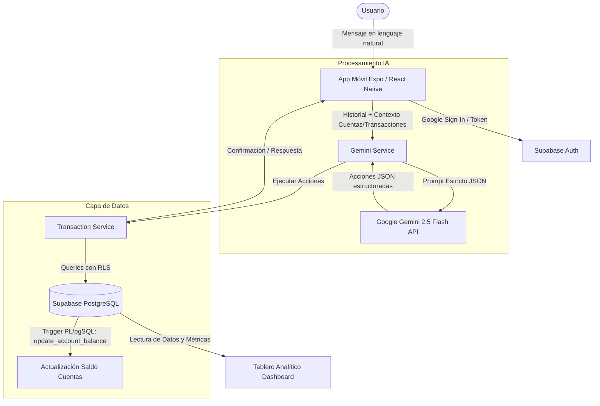

# 🪙 FINTUAL — Agente Financiero Inteligente

[](https://expo.dev)
[](https://reactnative.dev)
[](https://nativewind.dev)
[](https://supabase.com)
[](https://deepmind.google/technologies/gemini/)
[](https://www.typescriptlang.org/)

**FINTUAL** es una aplicación móvil moderna desarrollada con **React Native** y **Expo**, impulsada por un asistente conversacional de inteligencia artificial (**Sami**, potenciado por **Google Gemini 2.5 Flash**). Permite registrar, clasificar y controlar finanzas personales, ingresos, gastos y múltiples cuentas bancarias en tiempo real utilizando lenguaje natural cotidiano, todo respaldado por una base de datos segura y reactiva en **Supabase**.

---

## 📑 Tabla de Contenidos

- [Descripción de la Aplicación](#-descripción-de-la-aplicación)
- [Funcionalidades](#-funcionalidades)
- [Cómo Funciona](#-cómo-funciona)
  - [Arquitectura de Alto Nivel](#arquitectura-de-alto-nivel)
  - [Flujo de Procesamiento del Agente Conversacional (Sami)](#flujo-de-procesamiento-del-agente-conversacional-sami)
  - [Modelo y Lógica de Base de Datos](#modelo-y-lógica-de-base-de-datos)
- [Tecnologías Utilizadas](#-tecnologías-utilizadas)
- [Estructura del Proyecto](#-estructura-del-proyecto)
- [Instalación](#-instalación)
  - [Prerrequisitos](#prerrequisitos)
  - [1. Clonar el repositorio](#1-clonar-el-repositorio)
  - [2. Instalar dependencias](#2-instalar-dependencias)
  - [3. Configuración de Variables de Entorno](#3-configuración-de-variables-de-entorno)
  - [4. Configuración de Base de Datos en Supabase](#4-configuración-de-base-de-datos-en-supabase)
  - [5. Configuración de Google Cloud Console (OAuth)](#5-configuración-de-google-cloud-console-oauth)
- [Uso de la Aplicación](#-uso-de-la-aplicación)
  - [Comandos de Ejecución](#comandos-de-ejecución)
  - [Ejemplos de Comandos en el Chat con Sami](#ejemplos-de-comandos-en-el-chat-con-sami)
- [Scripts Disponibles](#-scripts-disponibles)
- [Licencia](#-licencia)

---

## 💡 Descripción de la Aplicación

La mayoría de las personas abandonan el registro financiero personal debido a la fricción que implica llenar formularios manuales con montos, fechas, categorías y cuentas. 

**FINTUAL** elimina por completo esa barrera transformando la gestión de finanzas en una conversación fluida. Los usuarios simplemente interactúan con **Sami**, un asistente financiero experto que interpreta frases informales como *"Ayer me gasté 25 mil en hamburguesas pagando con Bancolombia"* o *"Cobra 19% de IVA en la factura de $120.000 de internet"*, extrayendo de manera determinista los datos, solicitando información faltante si existe ambigüedad y sincronizando saldos y métricas en tableros analíticos en tiempo real.

---

## ✨ Funcionalidades

### 💬 Asistente Conversacional Inteligente (Sami)
* **Procesamiento de Lenguaje Natural (PLN):** Interpreta transacciones completas a partir de texto libre sin necesidad de formularios rígidos.
* **Inferencia Temporal Inteligente:** Calcula fechas relativas (*"ayer"*, *"el lunes pasado"*, *"antier"*) basándose en la fecha del sistema.
* **Categorización Automática:** Deduce categorías lógicas (*Alimentación*, *Transporte*, *Ocio*, *Servicios*, etc.) considerando el historial reciente del usuario.
* **Cálculo de Impuestos y Reglas:** Detecta y calcula automáticamente impuestos como el IVA (19%) o gravámenes como el 4x1000 según las reglas configuradas en cada cuenta.
* **Manejo de Ambigüedad:** Si el usuario tiene múltiples cuentas y olvida indicar de cuál realizó el movimiento, Sami formula preguntas de aclaración antes de guardar.
* **Acciones Múltiples y Transferencias:** Capacidad de procesar varios gastos simultáneos o desglosar transferencias entre cuentas (egreso de origen + ingreso en destino).
* **Actualización y Eliminación por Lenguaje Natural:** Búsqueda y modificación o borrado de transacciones previas (*"Actualiza el tinto de ayer a $4.000"*, *"Elimina el gasto de taxi"*).

### 💳 Gestión Multicuenta
* Creación y configuración de cuentas (ej. *Nequi*, *Daviplata*, *Bancolombia*, *Efectivo*, *Tarjeta de Crédito*).
* Definición de saldos iniciales y reglas particulares por cuenta.
* Actualización atómica y bidireccional del saldo ante cualquier inserción, modificación o eliminación de transacciones.

### 📊 Dashboard Analítico y Flujo de Caja
* **Tarjetas de Balance Global:** Visualización instantánea de Total de Ingresos, Total de Gastos y Balance Neto del mes actual.
* **Distribución de Gastos:** Gráfico circular (*PieChart*) interactivo que desglosa los gastos por categoría.
* **Flujo de Caja:** Gráfico de líneas (*LineChart Bezier*) con la evolución y tendencia de las transacciones de los últimos días activos.
* **Monitoreo de Cuentas:** Cuadrícula con el balance individualizado de cada cuenta bancaria o billetera.

### 🔐 Seguridad y Autenticación
* Inicio de sesión con cuenta de Google mediante **Google Sign-In** nativo.
* Protección de datos con **Row Level Security (RLS)** en PostgreSQL: cada usuario accede únicamente a sus cuentas y transacciones.
* Persistencia segura de sesión en el dispositivo con AsyncStorage.

### 🎨 Experiencia de Usuario (UI/UX)
* Interfaz reactiva estilizada con **Tailwind CSS / NativeWind**.
* Soporte nativo para modo claro y modo oscuro (*Dark Mode*).
* Navegación por pestañas intuitiva construida con **Expo Router**.

---

## ⚙️ Cómo Funciona

### Arquitectura de Alto Nivel



### Flujo de Procesamiento del Agente Conversacional (Sami)

1. **Captura y Enriquecimiento de Contexto:** Cuando el usuario envía un mensaje, la app extrae las cuentas activas del usuario y las 20 transacciones más recientes desde Supabase.
2. **Generación con Gemini 2.5 Flash:** Se envía el historial de conversación junto con el contexto y la fecha actual a la API de Google Gemini utilizando modo JSON estricto (`responseMimeType: "application/json"`).
3. **Parseo de Intenciones:** Gemini devuelve un arreglo de acciones estandarizadas que pueden ser:
   * `registrar_transaccion`: Crea un ingreso o gasto con fecha, monto, categoría, cuenta e impuestos.
   * `preguntar`: Solicita información faltante si el mensaje es ambiguo.
   * `configurar_cuenta`: Da de alta una nueva cuenta con saldo inicial y reglas.
   * `actualizar_transaccion`: Modifica un movimiento previo mediante búsqueda por coincidencia textual (`ilike`).
   * `eliminar_transaccion`: Suprime un movimiento existente.
4. **Ejecución y Persistencia:** [`src/app/(tabs)/index.tsx`](src/app/(tabs)/index.tsx:58) procesa el arreglo invocando los métodos de [`src/services/transactionService.ts`](src/services/transactionService.ts:1).
5. **Respuesta al Usuario:** Sami retroalimenta al usuario con un mensaje claro en el chat confirmando la operación.

### Modelo y Lógica de Base de Datos

La aplicación implementa disparadores (*triggers*) en PostgreSQL que garantizan la integridad contable:
* Cada vez que se inserta un gasto, se descuenta el monto y el impuesto del saldo de la cuenta asociada.
* Cada vez que se inserta un ingreso, se incrementa el saldo de la cuenta.
* En modificaciones (`UPDATE`) o eliminaciones (`DELETE`), se revierte el impacto anterior y se recalcula el saldo correspondiente de forma atómica.

---

## 🛠️ Tecnologías Utilizadas

| Categoría | Tecnología / Librería | Versión | Propósito |
| :--- | :--- | :--- | :--- |
| **Mobile Core** | [React Native](https://reactnative.dev) | `0.86.3` | Framework principal para la app móvil |
| **Plataforma & Tooling** | [Expo](https://expo.dev) | `~57.0.25` | Suite de desarrollo, compilación y runtime SDK 57 |
| **Navegación** | [Expo Router](https://docs.expo.dev/router/introduction/) | `~57.0.23` | Enrutamiento basado en archivos (File-based routing) |
| **Estilos & UI** | [NativeWind](https://www.nativewind.dev/) | `^4.2.7` | Tailwind CSS adaptado para React Native |
| **Estilos & UI** | [Tailwind CSS](https://tailwindcss.com/) | `^3.4.19` | Motor de estilos utilitarios |
| **Inteligencia Artificial** | [Google Generative AI](https://ai.google.dev/) | `^0.24.1` | SDK para Google Gemini (modelo `gemini-2.5-flash`) |
| **Backend & Base de Datos**| [Supabase JS](https://supabase.com/) | `^2.117.2` | Cliente para PostgreSQL, Auth y Row Level Security |
| **Autenticación** | [@react-native-google-signin/google-signin](https://github.com/react-native-google-signin/google-signin) | `^16.1.5` | Login nativo con cuentas de Google |
| **Persistencia Local** | [@react-native-async-storage/async-storage](https://react-native-async-storage.github.io/async-storage/) | `2.2.0` | Almacenamiento local de la sesión de autenticación |
| **Gráficos & Visualización**| [react-native-chart-kit](https://github.com/indiespirit/react-native-chart-kit) | `^7.0.4` | Renderizado de gráficos de torta y líneas bezier |
| **Gráficos Vectoriales** | [react-native-svg](https://github.com/software-mansion/react-native-svg) | `15.15.4` | Soporte SVG para componentes gráficos |
| **Iconografía** | [@expo/vector-icons](https://icons.expo.fyi/) | `^15.1.1` | Iconos vectoriales Ionicons |
| **Lenguaje** | [TypeScript](https://www.typescriptlang.org/) | `~6.0.3` | Tipado estático y robustez de código |

---

## 📂 Estructura del Proyecto

```text
agenteFinanciero/
├── assets/                       # Íconos, splash screen y recursos visuales
├── src/
│   ├── app/                      # Rutas de Expo Router
│   │   ├── (tabs)/               # Grupo de navegación por pestañas
│   │   │   ├── _layout.tsx       # Configuración de tabs (Chat y Dashboard)
│   │   │   ├── index.tsx         # Pantalla principal del Chat con Sami
│   │   │   └── dashboard.tsx     # Pantalla del Dashboard con gráficos y métricas
│   │   ├── _layout.tsx           # Layout raíz con verificación de Auth y Providers
│   │   └── login.tsx             # Pantalla de bienvenida e inicio con Google
│   ├── context/
│   │   └── AuthContext.tsx       # Contexto global de sesión de Supabase
│   └── services/
│       ├── geminiService.ts      # Cliente y prompts estructurados para Gemini 2.5
│       ├── supabaseClient.ts     # Configuración e instanciación del cliente Supabase
│       └── transactionService.ts # Métodos CRUD para cuentas y transacciones
├── alter_schema.sql              # Scripts SQL iniciales
├── alter_schema_v2.sql           # Migración para tabla 'accounts' y llaves foráneas
├── alter_schema_v3.sql           # Triggers PL/pgSQL para balance automático
├── supabase_schema.sql           # Esquema base con políticas RLS
├── app.json                      # Configuración de la aplicación en Expo
├── babel.config.js               # Configuración del compilador Babel y NativeWind
├── global.css                    # Directivas de Tailwind CSS
├── metro.config.js               # Configuración del empaquetador Metro
├── package.json                  # Dependencias y scripts del proyecto
├── tailwind.config.js            # Configuración de temas y rutas de NativeWind
└── tsconfig.json                 # Configuración de TypeScript
```

---

## 🚀 Instalación

### Prerrequisitos
* [Node.js](https://nodejs.org/) (versión 18 o superior recomendada).
* [Git](https://git-scm.com/) instalado en tu sistema.
* Gestor de paquetes `npm`, `yarn` o `bun`.
* Dispositivo móvil con la app **Expo Go** o un emulador de Android / simulador de iOS configurado.
* Una cuenta en [Supabase](https://supabase.com).
* Una API Key de [Google AI Studio](https://aistudio.google.com/) para acceder a Gemini.
* Un proyecto en [Google Cloud Console](https://console.cloud.google.com/) con credenciales OAuth 2.0 (Web Client ID).

---

### 1. Clonar el repositorio

```bash
git clone https://github.com/tu-usuario/agenteFinanciero.git
cd agenteFinanciero
```

---

### 2. Instalar dependencias

Utiliza el gestor de paquetes de tu preferencia para instalar las dependencias:

```bash
npm install
```

> **Nota:** Para instalar módulos adicionales compatibles con Expo SDK 57, utiliza siempre `npx expo install <nombre-paquete>`.

---

### 3. Configuración de Variables de Entorno

Crea un archivo `.env` en la raíz del proyecto basándote en la siguiente plantilla:

```env
# Claves de Supabase
EXPO_PUBLIC_SUPABASE_URL=https://tu-proyecto.supabase.co
EXPO_PUBLIC_SUPABASE_ANON_KEY=tu_supabase_anon_key_aqui

# API Key de Google Gemini
EXPO_PUBLIC_GEMINI_API_KEY=tu_gemini_api_key_aqui

# OAuth Google Web Client ID
EXPO_PUBLIC_GOOGLE_WEB_CLIENT_ID=tu_google_web_client_id.apps.googleusercontent.com
```

---

### 4. Configuración de Base de Datos en Supabase

En tu panel de control de Supabase, dirígete al **SQL Editor** y ejecuta los scripts en el siguiente orden:

1. **`supabase_schema.sql`**: Crea la tabla `transactions` y habilita el Row Level Security (RLS).
2. **`alter_schema_v2.sql`**: Crea la tabla `accounts`, define las relaciones entre transacciones y cuentas, y añade el campo `tax_amount`.
3. **`alter_schema_v3.sql`**: Instala la función `update_account_balance()` y el trigger automático que recalcula los saldos de cada cuenta ante inserciones, actualizaciones o eliminaciones.

---

### 5. Configuración de Google Cloud Console (OAuth)

1. En la consola de Google Cloud, crea un ID de cliente de OAuth 2.0 de tipo **Web Application**.
2. Copia el **Client ID** generado y asígnalo a `EXPO_PUBLIC_GOOGLE_WEB_CLIENT_ID`.
3. En el panel de Supabase (**Authentication -> Providers -> Google**), habilita el proveedor Google e ingresa el Client ID y Client Secret correspondientes.

---

## 📱 Uso de la Aplicación

### Comandos de Ejecución

Inicia el entorno de desarrollo de Expo:

```bash
npx expo start
```

Desde la terminal interactiva puedes presionar:
* `a` para abrir en emulador de **Android**.
* `i` para abrir en simulador de **iOS**.
* `w` para abrir en el navegador **Web**.
* Escanear el código QR con la app **Expo Go** en tu dispositivo físico.

---

### Ejemplos de Comandos en el Chat con Sami

Una vez autenticado con tu cuenta de Google, puedes interactuar directamente con Sami en la pestaña **Chat**:

#### 1. Configurar una cuenta bancaria o billetera
> *"Crea una cuenta llamada Nequi con saldo inicial de 500000"*  
> *"Configura mi cuenta Bancolombia con 1200000 y regla de cobro 4x1000"*

#### 2. Registrar gastos e ingresos cotidianos
> *"Gasté $15.000 en almuerzo de hoy con Nequi"*  
> *"Ayer pagué $45.000 de gasolina desde Bancolombia"*  
> *"Recibí $800.000 de salario en mi cuenta Bancolombia"*

#### 3. Cálculo de impuestos automáticos
> *"Pagué servicio de consultoría por $200.000 con 19% de IVA desde Bancolombia"*

#### 4. Respuestas a preguntas clarificatorias
Si tienes varias cuentas y dices:
> *"Compré un café por $6.000"*  
Sami te responderá:  
> *¿De qué cuenta pagaste el café?*  
Solo responde:  
> *"De Nequi"*  
¡Y la transacción quedará asentada correctamente!

#### 5. Modificar o eliminar transacciones
> *"Actualiza el almuerzo de hoy a $18.000"*  
> *"Elimina el gasto de café"*

#### 6. Monitoreo en el Dashboard
Haz clic en la pestaña **Dashboard** para ver:
* Tarjetas de total de Ingresos, Gastos y Balance neto del mes.
* Saldos actualizados de cada cuenta.
* Gráfico de pastel con tus gastos agrupados por categoría (*Alimentación*, *Transporte*, *Hogar*, etc.).
* Gráfico de líneas con el flujo de ingresos y egresos a lo largo de los días.

---

## 📜 Scripts Disponibles

En el archivo [`package.json`](package.json) se incluyen los siguientes scripts de utilidad:

```bash
npm run start          # Inicia el bundler Metro con Expo
npm run android        # Compila y ejecuta la aplicación nativa en Android
npm run ios            # Compila y ejecuta la aplicación nativa en iOS
npm run web            # Inicia la versión web
npm run build:android  # Genera una compilación previa con EAS Build
```

Para validaciones y chequeos recomendados:

```bash
npx tsc --noEmit       # Verificación de tipos con TypeScript
npx expo-doctor        # Diagnóstico de salud y compatibilidad de dependencias Expo
```

---

## 📄 Licencia

Este proyecto se distribuye bajo los términos establecidos en el repositorio. Consulta el archivo [`LICENSE`](LICENSE) para más información.
